<div align="center">


# H.A.D.E.S

### Hybrid Automated Data Exchange System

**Describe an integration in plain English. The AI builds it, a human approves it, and the platform runs it, heals it,
and lets you manage it from Slack and WhatsApp.**


**[Live deployment](https://hedes-50047328087.development.catalystappsail.in)** ·
[User guide](docs/USER_GUIDE.md) · [Architecture](docs/ARCHITECTURE.md)

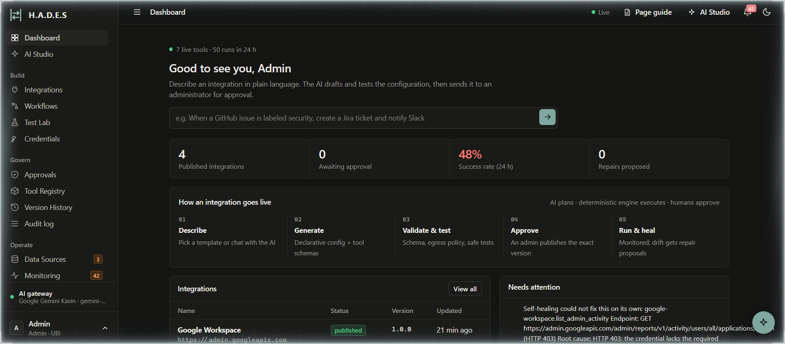

</div>

---

## The problem

Every team connects dozens of SaaS APIs: identity providers, ticketing, code hosting, security feeds, chat. Today that
means one of two things: wait for an automation tool to ship a connector, or write and maintain glue code. When an API
changes or a token expires, someone finds out days later from a broken dashboard.

AI can write that glue in seconds, but letting an LLM push code that calls production APIs with your credentials is not
something a security team will accept.

## The H.A.D.E.S answer

**AI plans, deterministic code executes, humans approve.**

- The AI reads the API's documentation and produces a **declarative configuration**, not code.
- A generic engine validates, security-reviews and **tests it against mocked responses**.
- An administrator approves **the exact version**; the approval is bound to the configuration's hash.
- Once live, every failure is **traced to its root cause and fixed automatically** where that's safe. Otherwise
  an admin gets an email, a Slack message or a WhatsApp message saying exactly what's needed.
- You can run all of it **from Slack or WhatsApp**: ask why something failed, have the AI fix it, and approve the fix
  with one button, without opening the app.

---

## What makes H.A.D.E.S different

| | Feature | What it means for you |
|---|---|---|
|  | **Manage it from Slack and WhatsApp** | Reply under a failure alert in Slack ("why did this fail?") and the AI investigates. It can change a workflow, run it or open an investigation, and the change runs only after you press **Approve** in Slack. WhatsApp alerts carry one-tap fix links, and a WhatsApp chatbot browses and acts on the platform. |
|  | **AI-built connectors, no code** | Describe the integration or paste an OpenAPI spec. The AI drafts a declarative config that the engine runs. No connector code, nothing to deploy. |
|  | **The AI can never act alone** | Every action the AI proposes waits for a human's approval. It can never approve or publish integrations, never sees secrets, and approval is bound to a SHA-256 hash of the exact config. |
|  | **Self-healing with a root cause** | Failures are investigated automatically: the AI collects evidence, finds the root cause, tries safe fixes (re-probe, re-test, corrected endpoint) and re-tests. What it can't fix goes to admins with *root cause, what was tried, what's still failing, what's needed*. |
|  | **Workflows that start themselves** | Besides manual, webhook and schedule triggers, a workflow can start **automatically** on a failure, an alert or a new data-source record, with conditions. It also guards against runaway loops. |
|  | **"Continue with Google", then import everything** | Sign in with Google, Microsoft, GitHub or Atlassian (OAuth 2.0 + PKCE). One sign-in asks for the scopes of every data source that provider offers, then imports them all. Tokens are vaulted and auto-refreshed. |
|  | **Tested before it touches a live API** | Schema-derived safe tests run every operation against a mocked transport, including expired-credential and error-path cases, before review. |
|  | **MCP gateway for AI agents** | Admin-approved tools are exposed to any MCP client (Claude, IDE agents) with role-based access. Agent tokens can run tools but can never govern. |
|  | **Bring any AI model** | 13+ providers (Amazon Bedrock, Gemini, OpenAI, Anthropic, Groq, NVIDIA NIM, xAI, Mistral, DeepSeek, Ollama…) or any OpenAI-compatible endpoint, routed per task with fallbacks, budgets and confidentiality rules. A built-in offline model keeps the core pipeline working without any key. |

### How it compares

| Capability | Typical workflow automation tools | **H.A.D.E.S** |
|---|---|---|
| New API without a ready-made connector | Usually a generic HTTP step you configure by hand, or custom code | AI reads the docs and drafts a validated, tested connector |
| AI in the loop | Usually suggests steps that you then build | Builds, explains, fixes and runs things, **always behind human approval** |
| What gets approved | Usually a workflow, by its author | The **exact config hash**, by an administrator, with a security review |
| When an API changes or a token expires | A run fails and someone notices | Failure classified, root cause found, fix tried or repair proposed, admin told what's needed |
| Running it from chat | Usually notifications only | Two-way: ask the AI, approve changes and run workflows from Slack; alerts with fix links and a chatbot on WhatsApp |
| Data that arrives | Each app's own format | Normalised into one common event/user/device format with de-duplication and a dead-letter queue |
| Exposing tools to AI agents | Usually not available | Built-in MCP gateway with per-tool roles |

---

##  Manage it from Slack

<table>
<tr>
<td width="50%">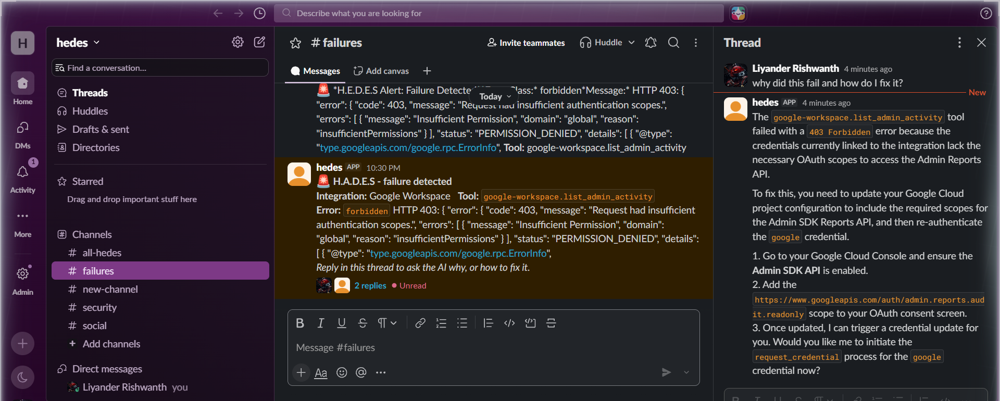</td>
<td width="50%">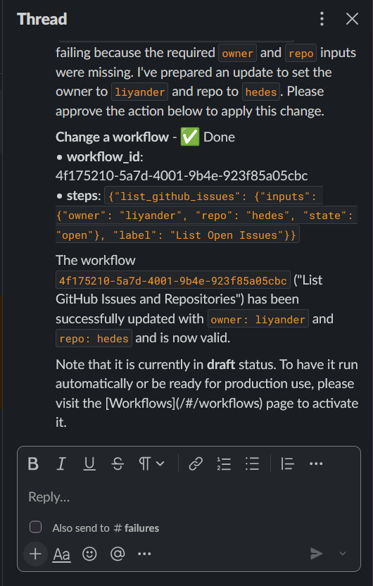</td>
</tr>
<tr>
<td><b>Alerts become conversations.</b> A failure posts to <code>#failures</code>. Reply in the thread and the AI reads the
alert, looks up the failing integration and explains the root cause and the fix. Here: the Google sign-in lacked the
Admin Reports scope.</td>
<td><b>Fix it without leaving Slack.</b> "Fix this using owner liyander and repo hedes": the AI proposes the change and
H.A.D.E.S posts <b>Approve / Reject</b> buttons. Only the person who asked can approve. Then it runs and reports back.</td>
</tr>
</table>

- **Everything the in-app assistant can do:** questions, failures, self-healing cases, creating, changing, activating and
  running workflows, running tools.
- **Approval first:** the AI asks for missing details before it offers an Approve button, so you never approve something
  half-specified.
- **Your identity and role:** Slack users are linked to H.A.D.E.S accounts with a one-time code, and every action runs
  with that person's own role. Unlinked or demoted users are refused.
- **Socket Mode:** H.A.D.E.S connects out to Slack, so no public webhook URL is needed. If the bot and app tokens come
  from different Slack apps, it says so.
- **Failure alerts:** a dedicated alert channel, and channel mentions are shown as their real names.

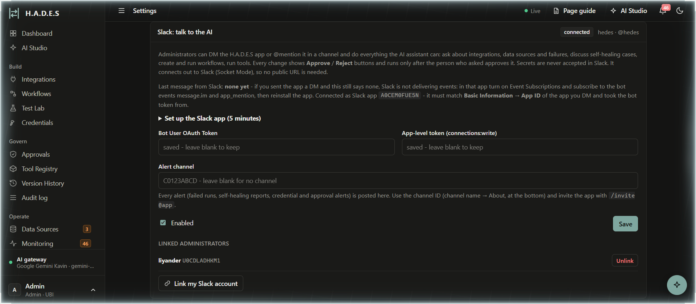

##  WhatsApp alerts with one-tap fixes and a chatbot

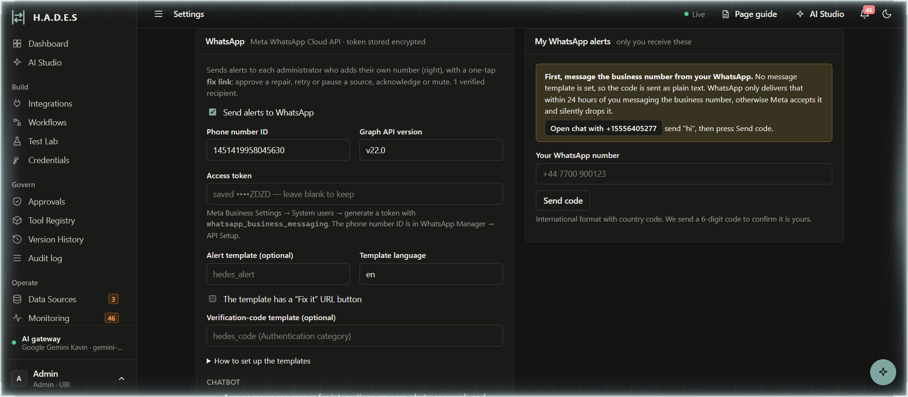

- **Personal alerts:** each admin verifies their own number with a 6-digit code and chooses a minimum severity.
- **One-tap fix links:** each alert opens a Fix page offering only the actions that apply. **Approve fix & publish**,
  **Retry now**, **Pause / Resume**, **Reconnect credential**, **Acknowledge**, **Mute 1 h / 24 h**. All run signed in as
  you, and are audited.
- **Chatbot:** message the business number to browse integrations, data sources, alerts, approvals and workflows,
  approve or reject with a confirm step, or ask the AI anything.

---

##  AI Studio: build by describing

<table>
<tr>
<td width="50%">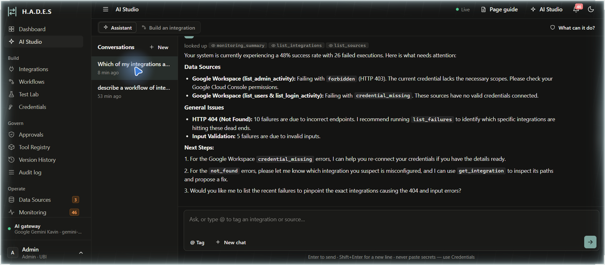</td>
<td width="50%">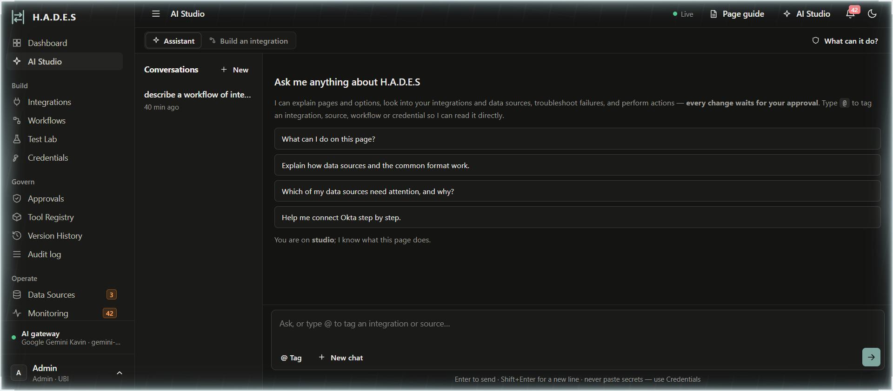</td>
</tr>
</table>

- **The assistant knows your platform.** It runs read-only lookups itself (shown as "looked up …"). Type `@` to tag an
  integration, source, workflow or credential, and it reads that item's configuration, health and recent errors, never
  its secrets.
- **Actions are cards.** Anything that changes data or calls an API appears as an approval card with the exact inputs,
  and runs with your permissions.
- **Build an integration:** a persisted pipeline goes *requirements → API discovery → config generation → validation →
  security review → safe tests → submit for approval*. It looks up official documentation online, tells you how to find
  each value it needs, lists its sources, and asks before creating anything.

##  Integrations that explain themselves

<table>
<tr>
<td width="50%">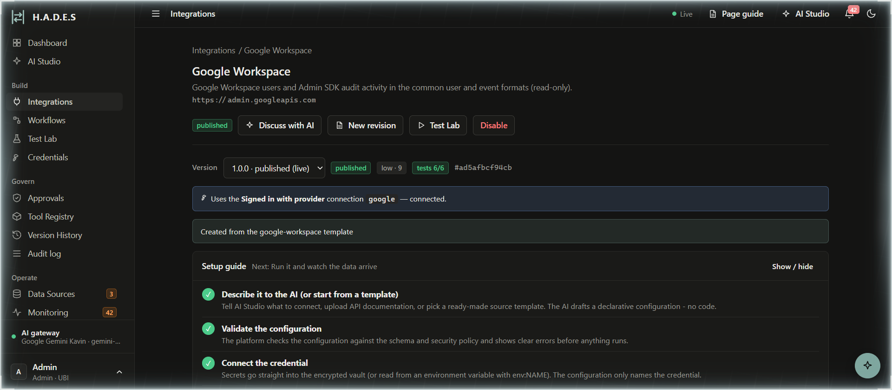</td>
<td width="50%">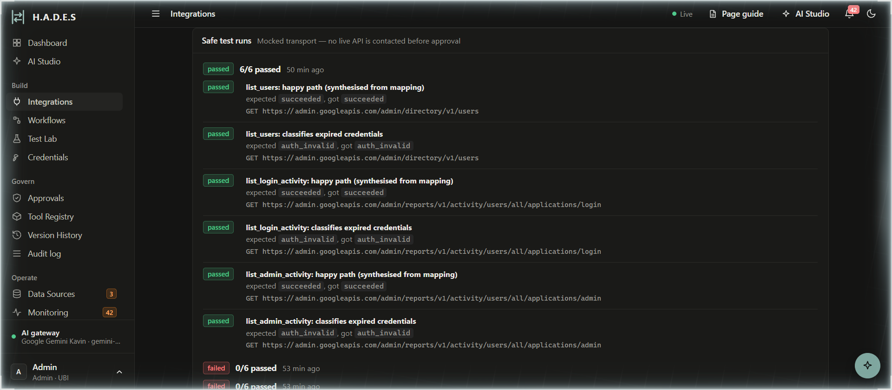</td>
</tr>
</table>

- **Setup guide:** every integration shows its own seven-step guide, from describe to running, with the state of each
  step.
- **Safe tests:** each operation is tested against a mocked transport: the happy path built from its field mapping, and
  expired-credential classification. Every test shows the exact request it would make.
- **Generic engine, no per-service code:**
  - **8 auth types:** bearer, API key in a header or query, basic, Okta SSWS, OAuth2 client credentials,
    **OAuth2 sign-in**, AWS SigV4.
  - **Pagination:** page, cursor, offset, `Link` header, next-page URL in the body.
  - **Requests:** retries with backoff and `Retry-After`, rate caps, response-success rules.

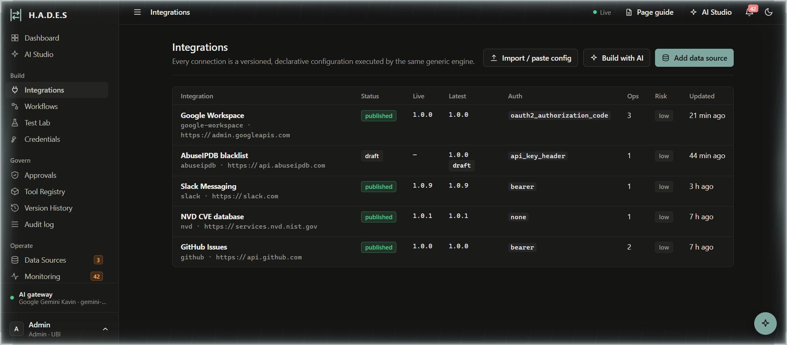

##  Workflows: manual, webhook, schedule, or automatic

<table>
<tr>
<td width="50%">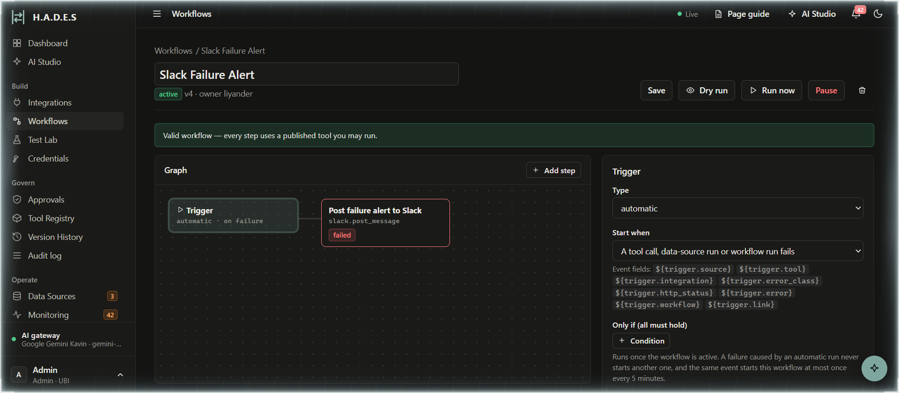</td>
<td width="50%">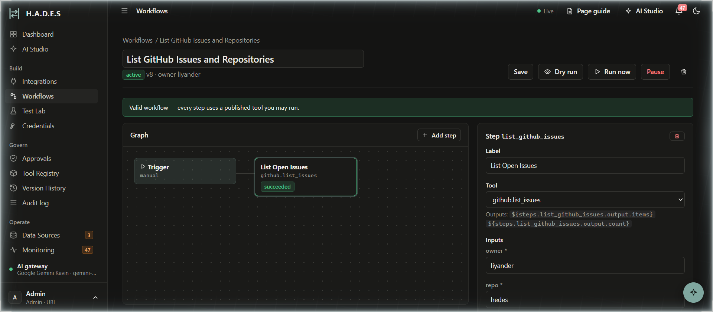</td>
</tr>
</table>

- **Visual editor:** a DAG with parallel layers, per-step conditions and `${steps.x.output.y}` references, plus dry runs
  that show every request without sending it.
- **Automatic triggers:** *a tool call, data-source run or workflow run fails*, *H.A.D.E.S raises an alert*, or *a data
  source stores a new record*, each with optional conditions such as `${trigger.severity} eq critical`.
- **Loop-safe:** a failure caused by an automatic run never starts another one, the same event starts a workflow at most
  once every 5 minutes, and bursts are capped.
- **Signed webhooks:** HMAC signature, timestamp window and replay protection.

##  Self-healing that tells you the root cause

<table>
<tr>
<td width="50%">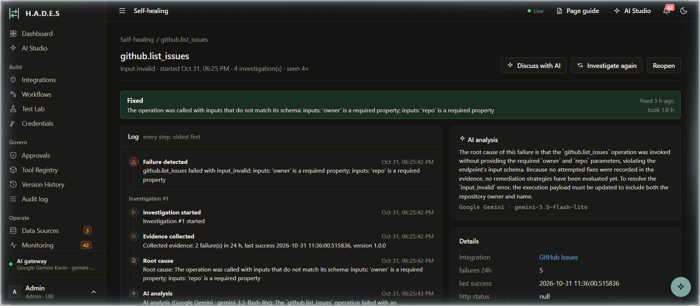</td>
<td width="50%">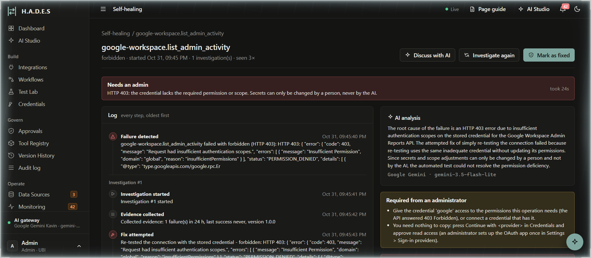</td>
</tr>
</table>

Every failure opens a case with a timestamped log:

1. failure detected;
2. evidence collected;
3. root cause;
4. AI analysis (with the model it used);
5. each fix attempted and its result;
6. outcome and notifications.

Safe fixes are applied automatically: correcting a wrong endpoint against the reference configuration, re-testing a
credential, re-probing a recovered service. Fixes that change behaviour become a **revision awaiting approval**. Secrets
are never changed by the AI; the case says exactly what a person must do.

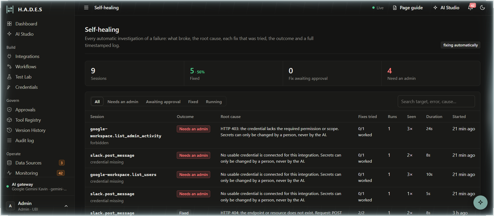

##  Monitoring and data sources

<table>
<tr>
<td width="50%">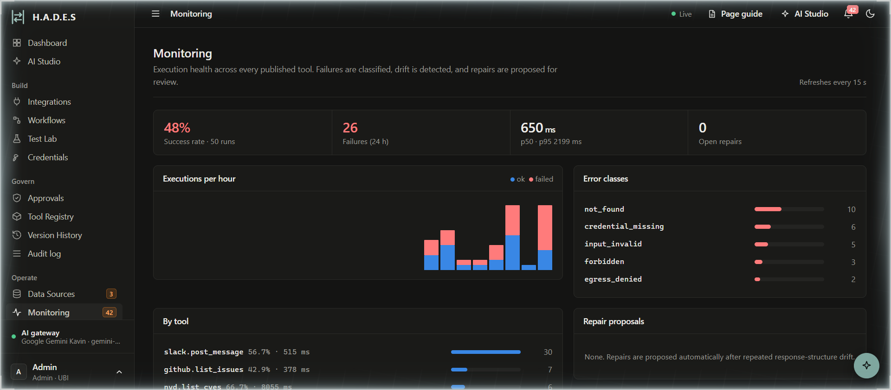</td>
<td width="50%">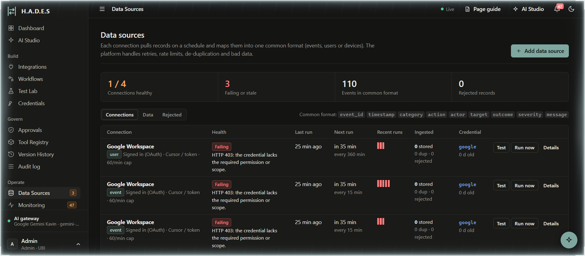</td>
</tr>
</table>

- **Monitoring:** success rate, p50/p95 latency and executions per hour. Failures are classified (`auth_invalid`,
  `forbidden`, `not_found`, `rate_limited`, `response_drift`…), each with a plain-language meaning and next step.
- **Data sources:** pull on an interval or cron schedule and map into **one common format** (event, user, device):
  - incremental sync from a high-water mark, de-duplication, upsert of users and devices;
  - a dead-letter queue for rejected records;
  - health per connection.

| Source template | Data | Sign-in |
|---|---|---|
|  **Google Workspace** | users, sign-in activity, Admin console changes | **Continue with Google** |
|  **Microsoft 365 / Entra ID** | users, sign-in logs, Defender security alerts | **Continue with Microsoft** |
|  **GitHub organisation** | members, Dependabot alerts | **Continue with GitHub** or token |
|  **Jira Cloud** | issues, users (site detected automatically) | **Continue with Atlassian** or API token |
|  Okta | users, System Log | SSWS token |
|  NVD CVE database | vulnerabilities | none / optional key |
|  CISA Known Exploited Vulnerabilities | alerts | none |
|  AbuseIPDB | IP blacklist | API key |

Adding another source means writing one YAML file in `examples/sources/`, or asking the AI to draft one.

##  Credentials and "Continue with …"

<table>
<tr>
<td width="50%">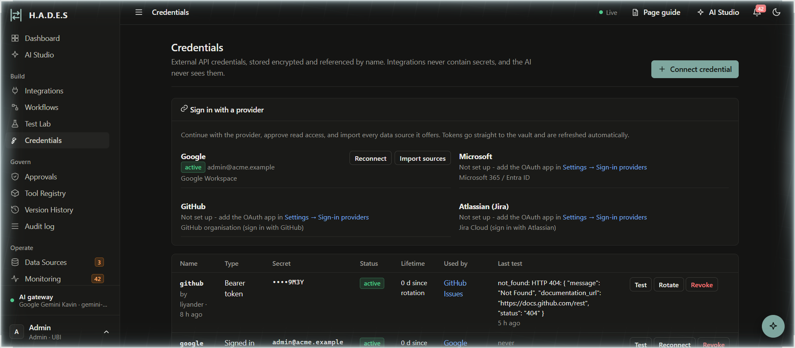</td>
<td width="50%">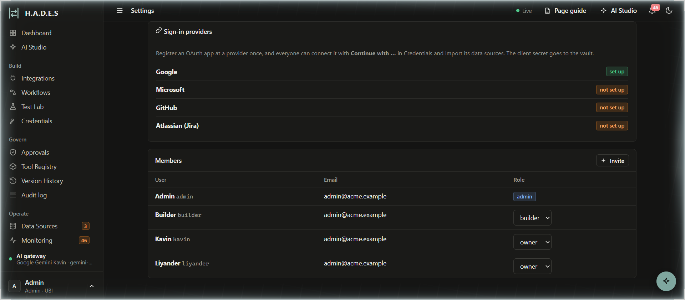</td>
</tr>
</table>

- **Encrypted vault:** secrets are encrypted with Fernet and referenced by name. Integrations never contain them, and
  the AI never sees them. `env:NAME` reads a server environment variable instead.
- **Credential hygiene:** expiry dates, rotation reminders and a Test button.
- **OAuth sign-in:**
  - PKCE, with the sign-in bound to the browser that started it, so a link someone else sends can't attach their account
    to your organisation;
  - tokens refreshed automatically, once even when several steps run in parallel.

##  Governance built in

<table>
<tr>
<td width="50%">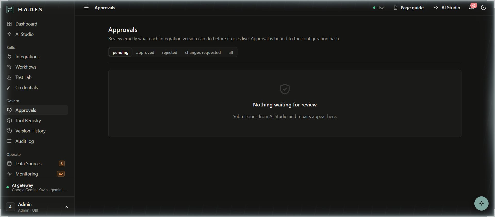</td>
<td width="50%">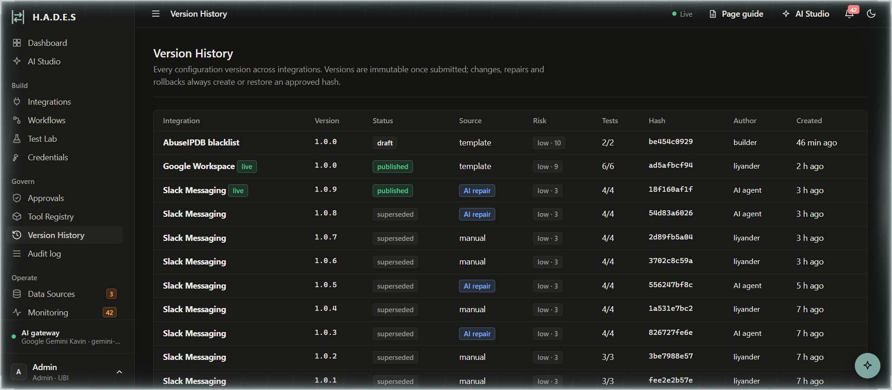</td>
</tr>
<tr>
<td width="50%">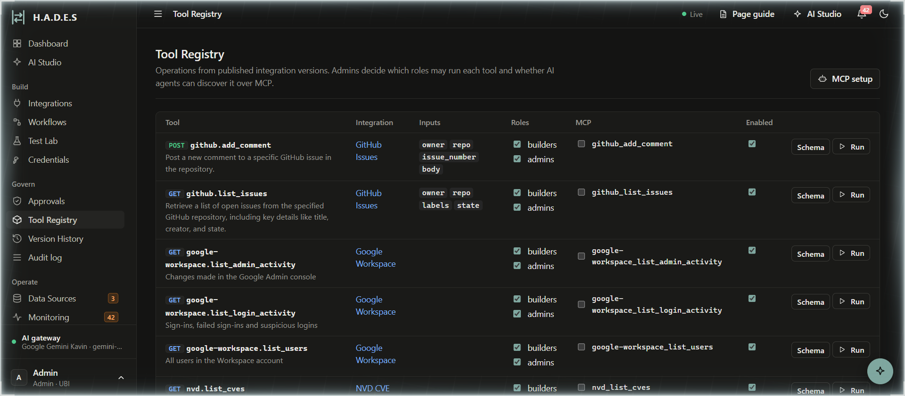</td>
<td width="50%">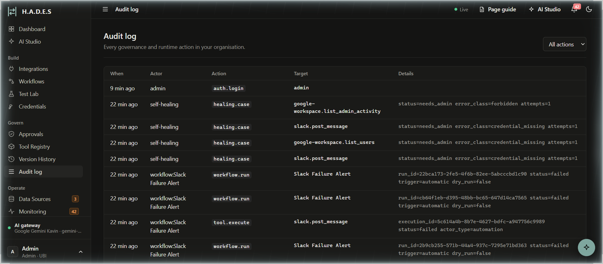</td>
</tr>
</table>

- **Approvals:**
  - immutable submitted versions, approved against their config hash;
  - credential and test gates;
  - self-approval flagged;
  - one-click rollback to any previously approved hash.
- **Tool registry:** per-tool role allow-lists and MCP exposure toggles.
- **Audit log:** every action by every person, the AI, workflows, MCP agents and Slack/WhatsApp.
- **Roles:** builder, admin, owner. API tokens can never approve, publish or change policy.

<table>
<tr>
<td width="50%">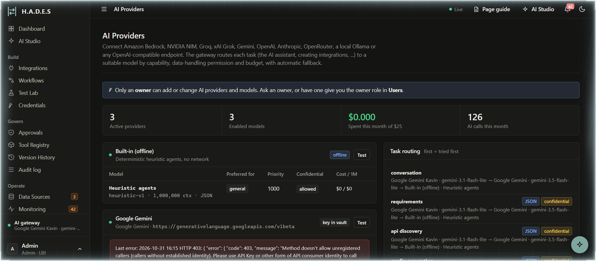</td>
<td width="50%">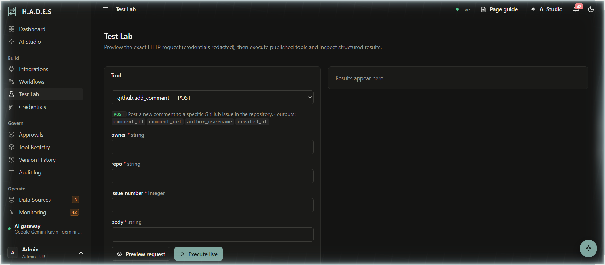</td>
</tr>
<tr>
<td width="50%">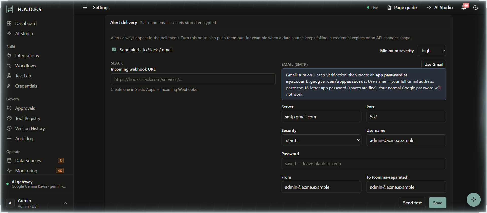</td>
<td width="50%">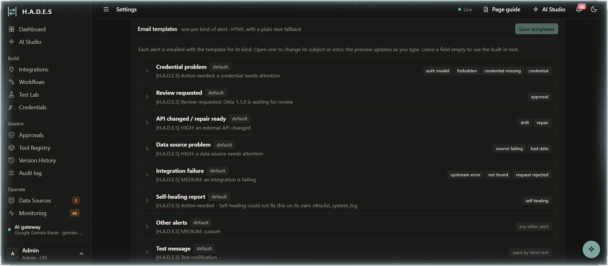</td>
</tr>
</table>

---

## How it works

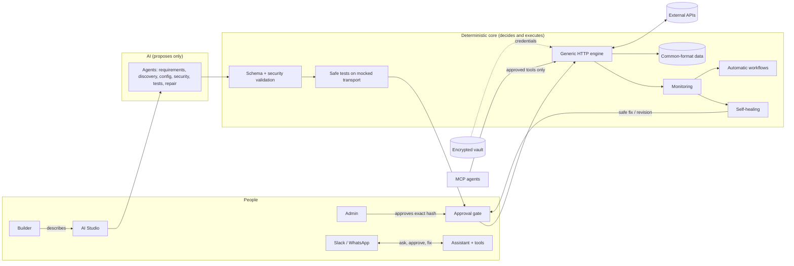

| Layer | Responsibility |
|---|---|
| **AI** | Proposes: requirements, API discovery, config generation, security narrative, tests, repairs, workflow plans, explanations |
| **Deterministic core** | Decides and executes: JSON-Schema + semantic validation, SSRF/egress checks, mocked tests, approval gate, generic engine, vault |
| **People** | Govern: approve exact versions, approve every AI action, roll back, set policy |

## Security model

| Control | How |
|---|---|
| AI isolation | The AI produces config and proposals only. It cannot execute changes, approve, publish, see secrets or change policy |
| Approval integrity | Approval is bound to the SHA-256 of the exact configuration; submitted versions are immutable |
| Secrets | Fernet-encrypted vault, referenced by name. Redacted from previews, logs and AI context |
| SSRF / egress | Scheme and host checks, private, link-local and metadata IPs blocked after DNS resolution, no redirects, optional domain allow-list |
| Injection | Restricted `${inputs.x}` templates and a JSONPath subset, no `eval`; documents shown to the AI are wrapped as untrusted |
| Sessions | bcrypt passwords, HttpOnly JWT cookie (`SameSite=Strict`), mandatory CSRF header, RBAC |
| OAuth | PKCE, one-time state bound to the browser by a nonce cookie, tokens vaulted and refreshed |
| Webhooks | HMAC-SHA256 signatures, 5-minute timestamp window, replay protection |
| Chat channels | Slack and WhatsApp users linked to accounts by one-time codes; actions run with that person's role, and only the requester can approve |

---

## Quick start

**Windows:** double-click `run.bat`. It creates a virtual environment, installs dependencies, creates `.env`, starts the
server and opens the browser. The first account you create becomes the administrator.
`run.bat demo` turns on bundled mock APIs for a demo, `run.bat test` runs the tests and `run.bat reset` starts afresh
with a backup.

**Manually:**

```bash
cd backend
pip install -r requirements.txt
uvicorn app.main:app --port 8000
```

Open http://127.0.0.1:8000. Add an AI provider under **AI Providers**: Gemini, OpenAI, Anthropic, Bedrock, Groq, NVIDIA
NIM, Ollama or any OpenAI-compatible URL. Interactive API docs are at `/docs`.

**Docker (PostgreSQL):** `cp .env.example .env && docker compose up --build`

### Deploy

| Target | How |
|---|---|
| **Zoho Catalyst AppSail** (live) | Managed Python 3.12 runtime with dependencies bundled for Linux. Step by step in [`deploy/catalyst`](deploy/catalyst/README.md) |
| **Neon PostgreSQL** | Set `DATABASE_URL=postgresql://…?sslmode=require`; the driver and pooler settings are handled automatically |
| **Docker** | `Dockerfile` + `docker-compose.yml` |

Keep `JWT_SECRET` and `SECRET_ENCRYPTION_KEY` the same everywhere a database is shared. The vault key is what decrypts
stored secrets.

## Tech stack

| Part | Choice | Why |
|---|---|---|
| API | FastAPI, Pydantic v2, Uvicorn | Typed request validation, async server, automatic OpenAPI docs |
| Data | SQLAlchemy 2, SQLite (local) / PostgreSQL (Neon) | One codebase, zero-setup locally, managed Postgres in production |
| Engine | httpx, JSON Schema, restricted templates + JSONPath | Declarative, sandboxed execution with no generated code |
| Security | cryptography (Fernet), bcrypt, PyJWT | Encrypted vault, password hashing, signed sessions |
| AI | Own gateway with adapters for OpenAI-compatible, Anthropic, Gemini, Bedrock + an offline model | Task routing, fallbacks, budgets, schema-validated output |
| Chat | Slack Socket Mode (websockets), Meta WhatsApp Cloud API | Two-way control without exposing a public webhook for Slack |
| UI | Vanilla JS ES modules, no build step | Fast, dependency-free, strict Content Security Policy |
| Hosting | Zoho Catalyst AppSail + Neon | Managed runtime and serverless Postgres |

## Tests

```bash
cd backend && python -m pytest tests -q      # 192 passed
```

The suite covers:

- **Engine and security:** every auth type and pagination style, SSRF and egress, validation, the vault.
- **Pipeline and governance:** the AI pipeline, approvals and rollback, the MCP gateway, data-source ingestion
  (including live CISA and NVD feeds).
- **Healing, workflows and sign-in:** self-healing, automatic workflow triggers, OAuth sign-in and token refresh.
- **Chat channels:** Slack conversations with approval buttons, WhatsApp alerts and fix links.
- **End to end:** a full run against a live server.

## Project structure

```
backend/app/
  api/          REST endpoints (auth, integrations, approvals, workflows, oauth, slack, whatsapp, healing, ...)
  services/     engine, ai_gateway, agents, orchestrator, healing, automation, oauth, slack_bot, whatsapp, vault, ...
  static/       single-page UI (no build step)
backend/tests/  192 tests
shared/         integration.schema.json, workflow.schema.json  (the contract)
examples/       integration configs and data-source templates (YAML)
docs/           USER_GUIDE.md, ARCHITECTURE.md, screenshots/
deploy/catalyst/  Zoho Catalyst AppSail entry point and config example
```

## Documentation

- **[User guide](docs/USER_GUIDE.md):** every page, option and role, explained.
- **[Architecture](docs/ARCHITECTURE.md):** data model, trust boundaries, configuration format.

## Known limits

- **Background work:** pipeline, healing, schedulers and the Slack connection run in-process threads. Use one instance,
  or add a queue before scaling out.
- **Database schema:** tables are created and extended automatically. Add Alembic migrations before the schema evolves
  in production.
- **DNS rebinding:** destinations are checked before each request but the connection is not pinned to the checked IP.
  Run behind an egress proxy in production.
